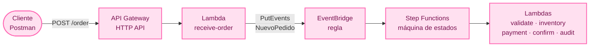
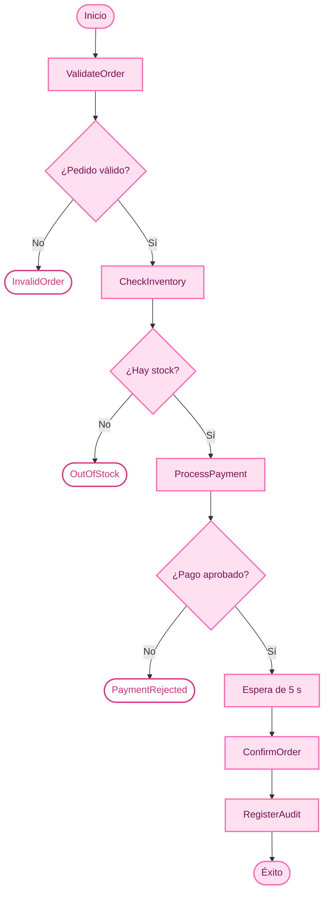

<div align="center">


# Automatización de solicitudes con API Gateway, EventBridge y Step Functions


*Procesamiento serverless de pedidos en AWS*

</div>

---

## 

En este laboratorio se construyó un flujo **serverless** que recibe pedidos por una API, los publica como evento y los procesa automáticamente paso a paso: validación, revisión de inventario, pago, confirmación y auditoría. No hay servidores que administrar: cada pieza se ejecuta solo cuando llega un pedido.

---

## 



---

## 

| Servicio | Qué se configuró |
|---|---|
| 🌸 **AWS Lambda** | Seis funciones en Python 3.11: `receive-order`, `validate-order`, `check-inventory`, `process-payment`, `confirm-order` y `register-audit` |
| 🌸 **IAM** | Permiso `events:PutEvents` para que `receive-order` pueda publicar eventos |
| 🌸 **Step Functions** | Máquina de estados *Standard* que encadena las Lambdas con decisiones y estados de falla |
| 🌸 **EventBridge** | Regla en el bus `default` que escucha `source: demo.pedidos` y `detail-type: NuevoPedido` y lanza la máquina de estados |
| 🌸 **API Gateway** | HTTP API con la ruta `POST /order` conectada a la Lambda `receive-order` |

---

## 



- ✅ **Validación:** cliente y producto no vacíos, cantidad y total mayores que 0.
- 📦 **Inventario:** hay stock si la cantidad es menor o igual a 5.
- 💳 **Pago:** se aprueba si el total es menor o igual a 1000.

---

## 

El archivo [MariaCamilaMejiaArango-Laboratorio-StepFunctions.pdf](./MariaCamilaMejiaArango-Laboratorio-StepFunctions.pdf) reúne las evidencias del laboratorio, en este orden:

1. 🌷 Funciones Lambda creadas
2. 🌷 Definición de la máquina de estados (JSON)
3. 🌷 Diagrama de la máquina de estados en Step Functions
4. 🌷 API Gateway: API HTTP `api-camilamejia`
5. 🌷 Prueba de la URL de la API en el navegador
6. 🌷 Prueba de la API con Postman

---

## 

Envía un `POST` a la URL de invocación de la API más la ruta `/order`, con este cuerpo JSON:

```json
{
  "cliente": "Johan",
  "producto": "Laptop",
  "cantidad": 1,
  "total": 900
}
```

```bash
curl -X POST https://<api-id>.execute-api.us-east-1.amazonaws.com/order \
  -H "Content-Type: application/json" \
  -d '{"cliente":"Johan","producto":"Laptop","cantidad":1,"total":900}'
```

La API responde con un `orderId`, y el resultado del procesamiento se ve en **Step Functions → Ejecuciones**. Para recorrer los otros caminos:

| Cambio en el cuerpo | Resultado esperado |
|---|---|
| `"cantidad": 6` | Termina en `OutOfStock` |
| `"total": 1500` | Termina en `PaymentRejected` |
| `"cliente": ""` | Termina en `InvalidOrder` |

---

## 

Al terminar la práctica se eliminan los recursos creados (API, regla de EventBridge, máquina de estados y Lambdas con sus roles y registros) para evitar costos innecesarios.

---

<div align="center">

Hecho con 💗 por **Maria Camila Mejia Arango**

*Bootcamp de computación en la nube*

</div>
